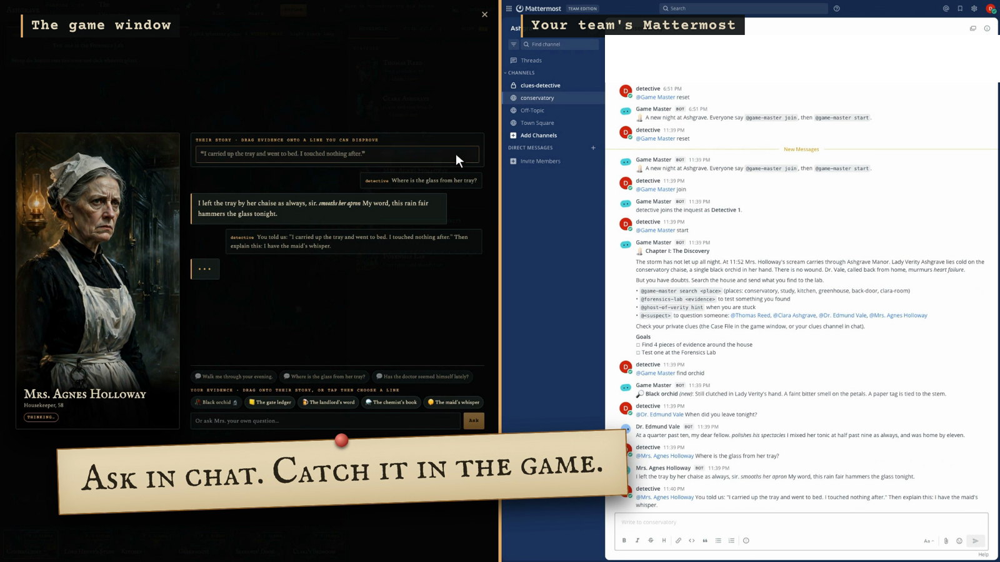

# Ashgrave: The Midnight Inquest

**A murder mystery your team solves together, inside the chat it already uses.**

Eight AI agents run the whole session in a Mattermost channel, connected through [Switch](https://docs.switchagents.ai): a game master, four suspects, the victim's ghost, a forensics lab and an evidence clerk. People do the thinking. They search the house, test evidence, catch the suspects lying and agree on who did it. Play it from the animated game window, from chat, or both at once: every move is a message in the same Switch room.

Built for **Flip the Switch** (WeMakeDevs × Switch, November 2026), Track 2: Best Personal or Creative Workflow.

- 🎬 **Demo video (2:40):** _link added at submission_
- 🕹️ **Live game:** https://game-production-e566.up.railway.app (see [Hosting](#hosting) for the current state)



## Why it's a team workflow, not just a game

Team-building usually means another app, another login and a host who prepares everything. Ashgrave needs none of that:

- **It lives in your team chat.** The game is a Mattermost channel. Nobody installs anything.
- **The agents host it.** The game master deals clues, runs the chapters and scores the accusation. The suspects improvise in character.
- **People collaborate.** Each detective gets secret clues in a private room and decides what to share. The case can only be solved by pooling what you know.
- **It ends with a result.** A verdict, a score and a reveal posted to the channel for everyone.

## How Switch is used

```
   Your team in Mattermost                 Switch                      8 AI agents (each its own Switch agent)
 ┌──────────────────────────┐      ┌──────────────────────┐      ┌────────────────────────────────────────┐
 │ #conservatory  (shared)  │◀────▶│ rooms                │◀────▶│ game-master      (game engine)         │
 │ 🔒 clues-<player>        │      │ events (WebSocket)   │      │ thomas-reed  clara-ashgrave            │
 │ (one private room each)  │      │ @addressing          │      │ dr-vale      mrs-holloway  (Muse Spark)│
 └──────────────────────────┘      │ Mattermost bridge    │      │ ghost-of-verity           (Muse Spark) │
              ▲                    └──────────────────────┘      │ forensics-lab (engine) evidence-clerk  │
              │ posts as the player                              └────────────────────────────────────────┘
   ┌──────────┴───────────┐
   │ Game window (React)  │  a view of the same room: every click is a Mattermost post
   └──────────────────────┘
```

**Agents.** All eight are registered with Switch's agent API (`POST /agents` with a registration key) and stay connected over Switch's WebSocket event stream (`/agents/{id}/connection/ws`), answering each ping. Each one acts only on `message` events where Switch marks it as **addressed**, so `@dr-vale` gets an answer from Dr. Vale and nobody else. Replies go back with `POST /agents/{id}/message`.

**Rooms.** `npm run setup:rooms` uses the game master's Switch operations (`list_bridges`, `create_room`) to create the rooms on the Mattermost bridge:

| Room | Members | Purpose |
|---|---|---|
| `#conservatory` | every player, all eight agents | The shared investigation |
| `🔒 clues-<player>` | one player, `game-master` | That detective's private clues |

**Addressing and greetings.** Players aren't the agents' owner, so the setup opens each agent to anyone in its rooms through the Gateway admin API (`PUT /gateway/agents/{id}/addressing-policy`), and turns off Switch's automatic "Hi! Tag @agent" greeting on the bridge so it doesn't break the mood.

**Secrets stay apart.** This is why it needs per-agent rooms and identities. Each suspect's prompt holds only its own secret, the private clues go only to their owner's room, and **no agent ever holds the solution**. The game engine decides when a lie breaks (a player presents the right evidence) and tells only that suspect what it may now admit.

**One room, two windows.** The game window never talks to the agents directly. It posts each action to Mattermost as the signed-in player (`/api/v4/posts`), Switch delivers it to the agents, and their replies come back through the room. So a teammate can type `@mrs-holloway where is the glass?` in chat and the answer appears in the game, and a lie caught in the game is stamped in chat.

## The cast

| Agent | Plays | Powered by |
|---|---|---|
| `game-master` | Chapters, searches, private clues, hints, accusation and scoring | Game engine (deterministic) |
| `thomas-reed`, `clara-ashgrave`, `dr-vale`, `mrs-holloway` | The four suspects, each with a story to protect | Meta Muse Spark 1.3 |
| `ghost-of-verity` | The victim's ghost: hints, and memories when shown evidence | Meta Muse Spark 1.3 |
| `forensics-lab` | Lab tests: the right test reveals, the wrong one fizzles | Game engine (deterministic) |
| `evidence-clerk` | Keeps the case file and points out contradictions | Meta Muse Spark 1.3 |

The painted rooms and portraits were generated with Meta's `muse-image-1.0` (`npm run art`).

## How to play

1. **Search by lantern.** Sweep the room; click whatever glints.
2. **Test it at the lab.** Pick the test you think fits. A wrong guess just fizzles.
3. **Piece the letter together.** A burned letter survives in the study fireplace.
4. **Catch the lie.** Each suspect's story is shown line by line. Drag in the evidence that disproves a line.
5. **Stuck?** Ask Lady Verity's ghost for a hint. The evidence board ties every clue to the lie it broke.
6. **Name the killer:** who, how and why. One accusation, no second chances.

Three short chapters, about 15 minutes. Story mode has no clock; Timed mode adds one. Solo play works: you hold all four secret clues.

From chat, the same game: `@game-master join`, `@game-master start`, `@game-master search study`, `@forensics-lab test the orchid for poison`, `@dr-vale when did you leave?`, `@game-master accuse vale how: poison why: stolen-work`, `@game-master help`.

## Run it locally

You need Docker, Node 22 and a [Meta Model API key](https://dev.meta.ai/docs/authentication) (optional: without it the characters give placeholder lines).

```bash
npm install
npm run infra:init     # generates infra/.env with fresh secrets, points .env at the stack
npm run infra:up       # Switch, Postgres, Mattermost, Gateway (docker compose, Switch 0.31.0)
# add MODEL_API_KEY to .env
npm run register       # registers the 8 agents with Switch and opens them to your rooms
npm run setup:rooms    # creates #conservatory and clues-detective on the Mattermost bridge
npm run ui:build
npm start              # agents connect; the game window opens at http://localhost:5180
```

Open http://localhost:5180, press **Enter as detective**, take the one-minute tour and begin. Mattermost is at http://localhost:8065 (player `detective`; the password is in `infra/.env`).

No Docker? `npm run sim -- --demo` plays a scripted solve in the terminal.

## Hosting

`Dockerfile` and `deploy/` run the stack on Railway: managed Postgres, `switch-core`, Mattermost, the Switch `setup` seeder, and the game. `deploy/start.sh` creates the databases, waits for Switch, registers the agents, creates the rooms and starts. A shared hosted game resets itself after 20 idle minutes.

**Current state:** the hosted stack runs end to end through Switch, but Meta's Model API returns no models to requests from Railway's US region, so the AI characters there fall back to placeholder lines. Running locally (above) gives the full experience.

## Development

```bash
npm test          # 22 tests: rules, chapters, hints, lab, puzzle, accusation, case consistency, leak checks
npm run typecheck
```

```
src/case/        the mystery as data (black-orchid.ts holds the spoilers)
src/engine/      rules and state; no network, no LLM
src/runtime/     the cast (prompts, handlers) and the game window's server
src/switch/      Switch agent client (HTTP + WebSocket) and Gateway admin calls
src/main.ts      runs all eight agents against a Switch server
ui/              the game window (React + Vite)
scripts/         register, setup-rooms, probe, simulator, art generation
infra/           Switch's standalone docker compose (0.31.0)
deploy/          Railway boot script and service setup
video/           the demo videos (HyperFrames projects)
```

## Credits

Sound effects in the demo video, CC BY 4.0: "water_bubbles_03" by audiolarx, "Papers Rustling" by f4ngy, "Pop, High, A (H1).wav" by InspectorJ (via Freesound). Narration made with Kokoro; music generated locally with MusicGen.
